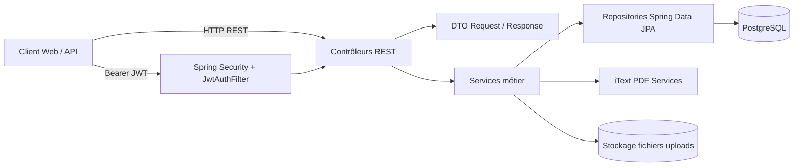
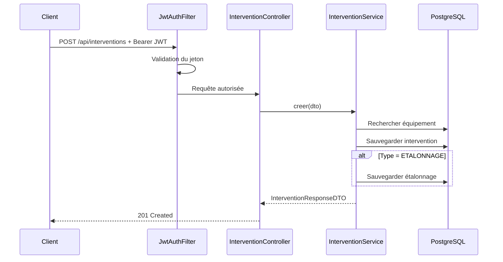
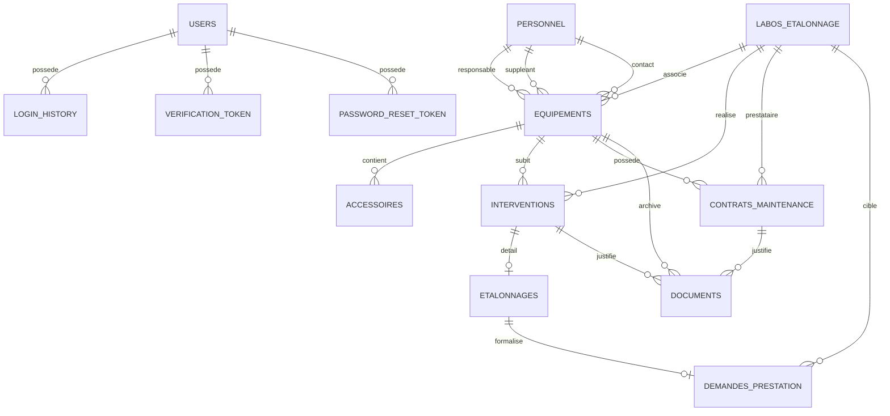

# Rapport de Stage

## Conception et réalisation d’une application web de gestion du laboratoire de métrologie CERT Calibration Hub

**Projet :** CERT Lab Manager / Calibration Hub  
**Structure d’accueil :** CERT — Laboratoire des Essais et de Mesure  
**Réalisé par :** [Nom et prénom du/de la stagiaire 1] — [Nom et prénom du/de la stagiaire 2]  
**Encadrant professionnel :** [Nom, fonction]  
**Encadrant académique :** [Nom, établissement]  
**Période de stage :** [Date début] — [Date fin]  
**Année universitaire :** [2025/2026]  
**Version du rapport :** 1.0 — 26/07/2026

> **Note d’édition :** les champs entre crochets doivent être complétés par vos informations réelles avant dépôt du rapport.

---

## Remerciements

Nous tenons à exprimer notre gratitude à l’ensemble de l’équipe du **CERT — Laboratoire des Essais et de Mesure** pour l’accueil, l’accompagnement et la confiance accordée durant cette période de stage. Nous remercions particulièrement notre encadrant professionnel **[Nom]** pour ses orientations techniques, ses retours réguliers et son aide dans la compréhension du contexte métier lié à la gestion des équipements de laboratoire, des opérations d’étalonnage et des documents qualité.

Nous adressons également nos remerciements à notre encadrant académique **[Nom]**, ainsi qu’à toute l’équipe pédagogique de **[Établissement]**, pour le suivi et les conseils méthodologiques ayant contribué à la réussite de ce projet.

---

## Résumé

Ce rapport présente les travaux réalisés dans le cadre d’un stage portant sur la conception et le développement d’une application web de gestion d’un laboratoire de métrologie, intitulée **Calibration Hub**. Le projet vise à digitaliser et centraliser la gestion des équipements, des interventions, des opérations d’étalonnage, des contrats de maintenance, des documents techniques et des alertes de suivi.

Le besoin métier principal est issu du processus qualité du laboratoire, notamment du formulaire **« Demande de Prestation de Service » — F/T/04, Mai 2025, Révision 04**, utilisé pour formaliser les demandes d’étalonnage. L’application développée transforme ce processus documentaire en fonctionnalités numériques : création d’équipements, association des laboratoires d’étalonnage, suivi des interventions, saisie des paramètres d’étalonnage, génération automatique de PDF, suivi de validité et alertes.

Sur le plan technique, l’application repose sur un backend **Java 17 / Spring Boot**, une base de données **PostgreSQL**, une couche d’accès aux données avec **Spring Data JPA / Hibernate**, des migrations avec **Flyway**, une sécurité basée sur **Spring Security** et **JWT**, et une génération documentaire avec **iText PDF**. L’architecture suit une organisation en couches : contrôleurs REST, services métier, repositories, entités JPA et DTOs.

**Mots clés :** Java, Spring Boot, PostgreSQL, JPA, Flyway, JWT, iText, étalonnage, laboratoire, gestion des équipements, maintenance, métrologie.

---

## Abstract

This report describes an internship project focused on designing and developing **Calibration Hub**, a web application for laboratory equipment and calibration management. The system centralizes equipment records, interventions, calibration operations, maintenance contracts, technical documents, alerts and dashboard indicators.

The business requirements were derived from the laboratory quality form **“Demande de Prestation de Service” — F/T/04, May 2025, Revision 04**. The application converts this document-based workflow into digital features, including equipment tracking, calibration request creation, conformity decision rules, uncertainty levels and automatic PDF generation.

Technically, the project is implemented using **Java 17**, **Spring Boot**, **PostgreSQL**, **Spring Data JPA**, **Flyway**, **Spring Security**, **JWT authentication** and **iText PDF generation**. The backend follows a layered architecture and exposes REST APIs that can be consumed by a web frontend.

---

## Table des matières

1. Introduction générale  
2. Présentation du contexte métier  
3. Analyse du formulaire PDF de demande de prestation  
4. Objectifs et cahier des charges  
5. Environnement technique  
6. Architecture de l’application  
7. Modélisation de la base de données  
8. Description détaillée des modules  
9. Sécurité et gestion des utilisateurs  
10. Documentation des API REST  
11. Génération des documents PDF  
12. Méthodologie de réalisation  
13. Tests, validation et qualité  
14. Déploiement et configuration  
15. Résultats obtenus, limites et perspectives  
16. Conclusion générale  
17. Annexes techniques

---

## Liste des abréviations

| Abréviation | Signification |
|---|---|
| API | Application Programming Interface |
| CRUD | Create, Read, Update, Delete |
| DTO | Data Transfer Object |
| EMT | Erreur Maximale Tolérée |
| JPA | Java Persistence API |
| JWT | JSON Web Token |
| ORM | Object Relational Mapping |
| PDF | Portable Document Format |
| REST | Representational State Transfer |
| SQL | Structured Query Language |
| UI | User Interface |
| UML | Unified Modeling Language |

---

# 1. Introduction générale

La gestion d’un laboratoire de métrologie exige un haut niveau de rigueur, de traçabilité et de maîtrise documentaire. Chaque équipement doit être identifié, affecté, suivi dans le temps, maintenu, étalonné et rattaché à des documents justificatifs. Les opérations d’étalonnage, en particulier, nécessitent une gestion précise des dates de validité, des résultats, des règles de décision, des niveaux d’incertitude et des déclarations de conformité.

Dans de nombreux environnements de laboratoire, ces informations sont encore dispersées entre des fichiers bureautiques, des formulaires papier, des dossiers locaux ou des échanges par courrier électronique. Cette organisation peut entraîner des risques : perte d’information, duplication des données, difficulté de recherche, absence d’alertes automatiques, retard de réétalonnage, manque de visibilité sur l’état du parc matériel et complexité dans la préparation des audits qualité.

Le projet **Calibration Hub** répond à ce besoin par la mise en place d’une application web centralisée. Le système permet d’enregistrer les équipements, d’historiser les interventions, de suivre les étalonnages, de générer des documents PDF conformes aux formulaires qualité et d’offrir des indicateurs synthétiques via un tableau de bord.

Ce rapport décrit le contexte, l’analyse fonctionnelle, la conception technique, l’architecture logicielle et les principaux modules développés dans le dépôt du projet **CERT-lab-manger-web-app**.

---

# 2. Présentation du contexte métier

## 2.1 Domaine d’application

Le projet s’inscrit dans le domaine de la **métrologie** et de la **gestion de laboratoire**. Un laboratoire de mesure doit garantir que les équipements utilisés restent fiables, correctement identifiés et conformes aux exigences internes ou normatives. Pour cela, il doit disposer d’un système assurant :

- l’identification unique de chaque équipement ;
- la gestion de son état et de son emplacement ;
- la conservation de son historique de vie ;
- la planification des maintenances et des étalonnages ;
- la conservation des certificats, rapports et contrats ;
- la génération de documents qualité ;
- la maîtrise des accès aux données sensibles.

## 2.2 Problématique

Avant digitalisation, le processus peut dépendre d’un formulaire papier ou PDF et d’une gestion manuelle des informations. Cette méthode montre plusieurs limites :

1. **Manque de centralisation :** les informations sont réparties sur plusieurs supports.
2. **Risque d’erreurs de saisie :** la duplication manuelle augmente les incohérences.
3. **Suivi difficile des échéances :** les dates de validité d’étalonnage, de garantie ou de contrat ne sont pas automatiquement surveillées.
4. **Traçabilité limitée :** il est difficile d’obtenir rapidement l’historique complet d’un équipement.
5. **Production documentaire lente :** les fiches de vie et demandes de prestation doivent être remplies manuellement.
6. **Sécurité insuffisante :** l’accès aux informations métier n’est pas toujours contrôlé selon les rôles.

## 2.3 Solution proposée

La solution proposée est une application backend exposant des API REST pour gérer les données du laboratoire. Elle permet de structurer les informations en base de données, d’appliquer les règles métier dans une couche de services, de sécuriser l’accès par JWT et de générer automatiquement les documents PDF nécessaires.

Le périmètre du dépôt analysé correspond principalement à la partie backend de l’application. Il fournit les services qui peuvent être consommés par une interface web, mobile ou un client API.

---

# 3. Analyse du formulaire PDF de demande de prestation

## 3.1 Document source analysé

Le dépôt contient un formulaire PDF intitulé **« DEMANDE DE PRESTATION DE SERVICE »**. L’extraction du contenu indique les informations suivantes :

- Référence : **F/T/04** ;
- Date de version : **Mai 2025** ;
- Révision : **04** ;
- Objet : demande de prestation liée à un matériel à étalonner ;
- Sections principales : client, date, matériel, prestation demandée, déclaration de conformité, commentaire, niveau d’incertitude et signatures.

Ce formulaire constitue une base fonctionnelle importante pour le module **Demande de Prestation** de l’application.

## 3.2 Champs métier du formulaire

| Zone du formulaire PDF | Interprétation métier | Implémentation dans l’application |
|---|---|---|
| Client | Organisme demandeur de la prestation | Paramètre applicatif `app.demande-prestation.client` |
| Date | Date de création de la demande | `DemandePrestation.dateDemande` |
| Désignation | Nom du matériel à étalonner | `Equipement.designation` |
| Type | Type ou modèle du matériel | `Equipement.modele` |
| Constructeur | Fabricant ou marque | `Equipement.marque` |
| N° de série | Numéro unique du matériel | `Equipement.numeroSerie` |
| Id | Identifiant interne | `Equipement.codeIdentifiant` |
| État à la livraison | Observation à réception | `DemandePrestation.etatALaLivraison` |
| Accessoires | Accessoires associés | Module `Accessoire` |
| Étalonnage au laboratoire / sur site | Lieu de la prestation | `DemandePrestation.lieu` : `LABORATOIRE` ou `SITE` |
| Comparaison inter-laboratoires | Indique une comparaison entre laboratoires | `DemandePrestation.comparaisonInterLabo` |
| Déclaration de conformité | Demande de jugement conforme/non conforme | `DemandePrestation.declarationConformite` |
| EMT | Erreur maximale tolérée | `Etalonnage.emt` |
| Bande de garde | Bande de garde appliquée | `Etalonnage.bandeGarde` |
| Règle de décision | Règle appliquée pour la conformité | `RegleDecision` |
| Points à étalonner | Points de mesure à contrôler | `DemandePrestation.pointsAEtalonner` |
| Niveau d’incertitude | Classe d’incertitude demandée | `NiveauIncertitude` |
| Signatures | Validation client et bureau réception | Générées dans le PDF final |

## 3.3 Règles de décision issues du formulaire

Le formulaire impose un choix de règle de décision lorsqu’une déclaration de conformité est demandée. Le modèle applicatif reprend ces choix via l’énumération `RegleDecision` :

| Règle du formulaire | Valeur applicative |
|---|---|
| Déclaration binaire pour simple acceptation | `BINAIRE_SIMPLE` |
| Déclaration binaire avec bande de garde | `BINAIRE_BANDE_GARDE` |
| Déclaration non binaire avec bande de garde | `NON_BINAIRE_BANDE_GARDE` |

## 3.4 Apport du module numérique

La transformation du formulaire PDF en module applicatif apporte plusieurs avantages :

- récupération automatique des informations de l’équipement ;
- réduction des erreurs de saisie ;
- centralisation de la demande dans la base PostgreSQL ;
- génération PDF automatique et homogène ;
- rattachement direct de la demande à une opération d’étalonnage ;
- historisation et recherche rapide des demandes.

---

# 4. Objectifs et cahier des charges

## 4.1 Objectif général

L’objectif principal du stage est de concevoir et développer un backend robuste pour une application web de gestion d’un laboratoire, couvrant le cycle de vie des équipements et les processus associés aux étalonnages, interventions, contrats, documents et utilisateurs.

## 4.2 Objectifs fonctionnels

Les objectifs fonctionnels identifiés sont les suivants :

1. **Gestion des utilisateurs**
   - inscription ;
   - activation par email ;
   - connexion sécurisée ;
   - réinitialisation du mot de passe ;
   - gestion des rôles.

2. **Gestion du parc équipements**
   - création, modification, consultation et réforme d’un équipement ;
   - recherche par désignation ;
   - filtrage par état ;
   - affectation à un responsable, suppléant et contact technique ;
   - association à un laboratoire d’étalonnage.

3. **Gestion du personnel et des laboratoires**
   - enregistrement des personnes liées aux équipements ;
   - gestion des laboratoires ou prestataires d’étalonnage.

4. **Gestion des interventions**
   - création d’interventions de maintenance, panne, vérification ou étalonnage ;
   - historisation par équipement ;
   - création automatique d’un enregistrement d’étalonnage lorsque le type d’intervention est `ETALONNAGE`.

5. **Gestion des étalonnages**
   - suivi de la date de validité ;
   - saisie de l’EMT ;
   - saisie de la bande de garde ;
   - résultat conforme, non conforme ou en attente.

6. **Gestion des contrats de maintenance**
   - rattachement à un équipement ;
   - dates de début et fin ;
   - période de maintenance ;
   - prestataire.

7. **Gestion documentaire**
   - téléversement de certificats, rapports, contrats, manuels, garanties ou autres documents ;
   - rattachement à un équipement, une intervention ou un contrat.

8. **Génération de documents PDF**
   - fiche de vie de l’équipement ;
   - demande de prestation de service conforme au formulaire F/T/04.

9. **Alertes et tableau de bord**
   - alertes sur les étalonnages arrivant à échéance ;
   - alertes sur les contrats proches de la fin ;
   - alertes sur les garanties proches de l’expiration ;
   - indicateurs de synthèse du parc.

## 4.3 Exigences non fonctionnelles

| Exigence | Description |
|---|---|
| Sécurité | Accès authentifié, mots de passe hachés, rôles, JWT |
| Maintenabilité | Organisation par couches, DTOs, services métier |
| Traçabilité | Historique des connexions, interventions et documents |
| Intégrité | Contraintes SQL, clés étrangères, champs uniques |
| Évolutivité | Architecture REST extensible |
| Portabilité | Exécution via Maven et configuration Spring Boot |
| Qualité documentaire | PDF standardisés et versionnés |
| Fiabilité des données | Migrations Flyway reproductibles |

---

# 5. Environnement technique

## 5.1 Technologies utilisées

| Couche | Technologie | Rôle |
|---|---|---|
| Langage | Java 17 | Développement backend |
| Framework | Spring Boot 4.1.0 | Socle applicatif |
| API Web | Spring Web MVC | Exposition des endpoints REST |
| Sécurité | Spring Security | Authentification et autorisation |
| Jetons | JJWT 0.13.0 | Génération et validation JWT |
| ORM | Spring Data JPA / Hibernate | Mapping objet-relationnel |
| Base de données | PostgreSQL | Persistance relationnelle |
| Migrations | Flyway | Versionnement du schéma SQL |
| Build | Maven | Gestion des dépendances et build |
| Email | Spring Mail | Activation de compte et reset password |
| PDF | iText 5.5.13.3 | Génération de fiches et formulaires PDF |
| Validation | Jakarta Bean Validation | Validation des DTOs |

## 5.2 Structure du projet

Le projet backend est situé dans le répertoire `calibration-hub`. L’organisation principale est :

```text
calibration-hub/
├── pom.xml
├── src/main/java/com/cert/calibration_hub/
│   ├── CalibrationHubApplication.java
│   ├── common/
│   │   └── GlobalExceptionHandler.java
│   ├── equipement/
│   │   ├── entités, contrôleurs, services, repositories
│   │   └── dto/
│   └── user/
│       ├── authentification, sécurité, utilisateurs
│       └── dto/
└── src/main/resources/
    ├── application.properties
    ├── db/migration/
    └── static/logo_cert.png
```

## 5.3 Choix techniques

Le choix de **Spring Boot** permet de développer rapidement une application robuste, modulaire et maintenable. **Spring Data JPA** simplifie l’accès aux données grâce aux repositories. **Flyway** assure que le schéma de base de données reste versionné, reproductible et contrôlé. **JWT** permet une authentification stateless adaptée aux architectures web modernes. Enfin, **iText** permet de produire des PDF professionnels directement depuis les données métier.

---

# 6. Architecture de l’application

## 6.1 Vue globale

L’application suit une architecture en couches :

1. **Couche API REST** : reçoit les requêtes HTTP et retourne les réponses JSON ou PDF.
2. **Couche service métier** : applique les règles métier, transactions et orchestrations.
3. **Couche repository** : communique avec la base de données via Spring Data JPA.
4. **Couche persistance** : PostgreSQL, fichiers uploadés et migrations Flyway.
5. **Couche sécurité** : filtre JWT, rôles et règles d’accès.



## 6.2 Flux standard d’une requête

Exemple : création d’une intervention d’étalonnage.

1. Le client envoie une requête `POST /api/interventions` avec un token JWT.
2. `JwtAuthFilter` valide le token et charge le rôle utilisateur.
3. `InterventionController` reçoit le DTO et déclenche la validation.
4. `InterventionService` vérifie l’existence de l’équipement et applique la règle métier.
5. Si le type est `ETALONNAGE`, le service crée aussi un enregistrement `Etalonnage`.
6. Les entités sont sauvegardées via `InterventionRepository` et `EtalonnageRepository`.
7. Le contrôleur retourne un `InterventionResponseDTO`.



## 6.3 Patrons de conception utilisés

| Patron / pratique | Utilisation dans le projet |
|---|---|
| Architecture en couches | Séparation contrôleur, service, repository |
| DTO | Isolation entre API et entités JPA |
| Repository | Abstraction d’accès aux données |
| Dependency Injection | Injection des services et repositories par Spring |
| Exception Handler centralisé | Gestion uniforme des erreurs via `@RestControllerAdvice` |
| Stateless authentication | Authentification par JWT sans session serveur |
| Database migration | Versionnement SQL avec Flyway |

---

# 7. Modélisation de la base de données

## 7.1 Migrations Flyway

Le schéma de la base est construit par les migrations situées dans `src/main/resources/db/migration` :

| Migration | Objet principal |
|---|---|
| `V1__create_users_table.sql` | utilisateurs, historique de connexion, tokens |
| `V2__create_equipements_table.sql` | équipements |
| `V3__interventions.sql` | interventions |
| `V4__etalonnages.sql` | étalonnages |
| `V5__contrats_maintenance.sql` | contrats de maintenance |
| `V6__documents.sql` | documents |
| `V7__personnel_accessoires.sql` | personnel, accessoires, affectations |
| `V8__labos_etalonnage.sql` | laboratoires d’étalonnage |
| `V9__lier_labo_etalonnage.sql` | liens vers laboratoires |
| `V10__demandes_prestation.sql` | demandes de prestation |

## 7.2 Schéma relationnel simplifié



## 7.3 Tables principales

### 7.3.1 Table `equipements`

Cette table représente le cœur du système. Elle contient les informations d’identification, les dates importantes, l’état courant et les relations avec le personnel et le laboratoire.

Champs significatifs :

- `code_identifiant` : identifiant interne unique ;
- `qr_code` : code unique utilisé pour l’identification rapide ;
- `designation`, `marque`, `modele`, `numero_serie` ;
- `date_acquisition`, `date_mise_en_service`, `date_reforme` ;
- `periodicite_valeur`, `periodicite_unite` ;
- `garantie_jusqu_au` ;
- `etat` : état de l’équipement ;
- `responsable_id`, `suppleant_id`, `contact_technique_id` ;
- `labo_etalonnage_id`.

### 7.3.2 Table `interventions`

Elle historise les interventions effectuées sur un équipement. Une intervention peut être une maintenance, une panne, une vérification ou un étalonnage.

Champs significatifs :

- `equipement_id` ;
- `type` ;
- `date_intervention` ;
- `nature_intervention` ;
- `cout` ;
- `numero_bon_intervention` ;
- `intervenant_nom`, `intervenant_societe` ;
- `statut` ;
- `labo_etalonnage_id`.

### 7.3.3 Table `etalonnages`

Elle détaille les données spécifiques à une intervention d’étalonnage.

Champs significatifs :

- `intervention_id` : relation un-à-un avec l’intervention ;
- `date_validite` ;
- `emt` ;
- `bande_garde` ;
- `resultat`.

### 7.3.4 Table `demandes_prestation`

Elle traduit le formulaire qualité F/T/04 en données structurées.

Champs significatifs :

- `etalonnage_id` ;
- `labo_etalonnage_id` ;
- `date_demande` ;
- `etat_a_la_livraison` ;
- `lieu` ;
- `comparaison_inter_labo` ;
- `declaration_conformite` ;
- `regle_decision` ;
- `points_a_etalonner` ;
- `niveau_incertitude`.

### 7.3.5 Tables de sécurité

Les tables `users`, `login_history`, `verification_token` et `password_reset_token` assurent la gestion des comptes, l’activation email, la réinitialisation du mot de passe et la traçabilité des connexions.

---

# 8. Description détaillée des modules

## 8.1 Module Authentification et Utilisateurs

### Fichiers principaux

- `AuthController.java`
- `UserController.java`
- `UserService.java`
- `SecurityConfig.java`
- `JwtAuthFilter.java`
- `JwtService.java`
- `EmailService.java`

### Fonctionnalités

Le module utilisateur gère le cycle de vie d’un compte : inscription, activation, connexion, consultation du profil, récupération et réinitialisation du mot de passe. Lors de l’inscription, le mot de passe est haché avec BCrypt et un token d’activation est généré. La connexion retourne un JWT contenant le nom d’utilisateur et le rôle.

Les rôles définis sont :

| Rôle | Description |
|---|---|
| `ADMINISTRATEUR` | Accès complet, gestion des utilisateurs |
| `CHEF_LABORATOIRE` | Gestion avancée des données métier |
| `PERSONNEL_AUTORISE` | Accès métier standard |

## 8.2 Module Équipements

### Fichiers principaux

- `Equipement.java`
- `EquipementController.java`
- `EquipementService.java`
- `EquipementRepository.java`
- `EquipementRequestDTO.java`
- `EquipementResponseDTO.java`

### Fonctionnalités

Ce module permet de gérer l’inventaire des équipements. Chaque équipement possède un code identifiant, un QR code, une désignation, une marque, un modèle, un numéro de série, des dates de cycle de vie, une périodicité et un état.

États possibles :

- `NOUVEAU`
- `DISPONIBLE`
- `EN_UTILISATION`
- `EN_ETALONNAGE`
- `EN_MAINTENANCE`
- `EN_PANNE`
- `HORS_SERVICE`
- `REFORME`

L’action de suppression logique correspond à une **réforme** : l’équipement passe à l’état `REFORME` et une date de réforme est enregistrée.

## 8.3 Module Personnel

Le module personnel permet d’enregistrer les personnes liées aux équipements. Un équipement peut avoir :

- un responsable ;
- un suppléant ;
- un contact technique.

Cette modélisation facilite la responsabilisation du suivi et la communication interne.

## 8.4 Module Laboratoires d’étalonnage

Le module `LaboEtalonnage` gère les laboratoires ou prestataires pouvant être associés aux équipements, interventions, contrats ou demandes de prestation. Il conserve le nom du laboratoire et les coordonnées du contact.

## 8.5 Module Interventions

Une intervention représente une action réalisée sur un équipement. Les types pris en charge sont :

- `ETALONNAGE` ;
- `MAINTENANCE_PREVENTIVE` ;
- `MAINTENANCE_CORRECTIVE` ;
- `PANNE` ;
- `VERIFICATION`.

La règle métier importante est la suivante : si le type est `ETALONNAGE`, le DTO doit contenir un bloc `etalonnage`. Dans ce cas, le service crée automatiquement l’intervention et l’entité `Etalonnage` associée dans une transaction.

## 8.6 Module Étalonnage

Le module d’étalonnage complète une intervention de type `ETALONNAGE`. Il permet de suivre :

- la date de validité ;
- l’EMT ;
- la bande de garde ;
- le résultat (`CONFORME`, `NON_CONFORME`, `EN_ATTENTE`).

La méthode `estExpire()` permet de déterminer si une date de validité est dépassée.

## 8.7 Module Contrats de maintenance

Un contrat de maintenance est rattaché à un équipement et contient le prestataire, la période de validité et la périodicité. La méthode `estValide()` détermine si le contrat est encore actif.

## 8.8 Module Documents

Le module documentaire permet d’associer des fichiers à un équipement, une intervention ou un contrat. Les types de documents sont :

- certificat d’étalonnage ;
- contrat de maintenance ;
- rapport ;
- manuel ;
- garantie ;
- autre.

Les fichiers sont stockés dans un répertoire configuré par `app.upload.dir`, avec une organisation par équipement.

## 8.9 Module Accessoires

Les accessoires permettent de compléter la description d’un équipement. Chaque accessoire contient une désignation, une marque et un numéro de série éventuel.

## 8.10 Module Alertes

Le service d’alertes recherche les éléments proches d’une échéance :

- étalonnages dont la date de validité approche ;
- contrats de maintenance proches de la fin ;
- garanties proches de l’expiration.

Le seuil est configurable dans la requête, par défaut 30 jours.

## 8.11 Module Tableau de bord

Le tableau de bord retourne une synthèse du parc : nombre total d’équipements, répartition par état, nombre de personnels et nombre d’accessoires.

## 8.12 Module Demande de prestation

Le module `DemandePrestation` est directement issu du formulaire PDF F/T/04. Il permet de créer, lister, consulter par étalonnage et télécharger une demande au format PDF.

---

# 9. Sécurité et gestion des utilisateurs

## 9.1 Authentification JWT

L’application utilise une authentification stateless basée sur JWT. Après connexion, l’utilisateur reçoit un token. Pour accéder aux ressources protégées, le client doit envoyer l’en-tête :

```http
Authorization: Bearer <token>
```

Le filtre `JwtAuthFilter` intercepte les requêtes, extrait le token, le valide, récupère le nom d’utilisateur et le rôle, puis alimente le contexte de sécurité Spring.

## 9.2 Autorisation par rôle

La configuration de sécurité définit les règles suivantes :

| Ressource | Accès |
|---|---|
| `/api/auth/**` | Public |
| `/api/users/**` | `ADMINISTRATEUR` uniquement |
| Méthodes DELETE sur les ressources métier | `ADMINISTRATEUR` ou `CHEF_LABORATOIRE` |
| Autres endpoints | Utilisateur authentifié |

## 9.3 Protection des mots de passe

Les mots de passe sont hachés avec `BCryptPasswordEncoder`. Aucun mot de passe en clair ne doit être stocké en base de données.

## 9.4 Activation et réinitialisation

Deux mécanismes par email sont prévus :

- activation du compte par token valide 24 heures ;
- réinitialisation du mot de passe par token valide 1 heure.

## 9.5 Recommandations de sécurité

Pour un environnement de production, il est recommandé de :

- remplacer les valeurs sensibles de `application.properties` par des variables d’environnement ;
- ne jamais versionner les mots de passe SMTP, secrets JWT ou mots de passe base de données ;
- définir une politique CORS explicite ;
- limiter la taille et les types MIME des fichiers uploadés ;
- journaliser les opérations critiques ;
- activer HTTPS ;
- mettre en place une rotation du secret JWT.

---

# 10. Documentation des API REST

## 10.1 Authentification

| Méthode | Endpoint | Description | Accès |
|---|---|---|---|
| POST | `/api/auth/register` | Inscription utilisateur | Public |
| GET | `/api/auth/verify?token=` | Vérification email | Public |
| POST | `/api/auth/login` | Connexion et obtention JWT | Public |
| GET | `/api/auth/me` | Profil utilisateur courant | Authentifié |
| POST | `/api/auth/forgot-password` | Demande de reset password | Public |
| POST | `/api/auth/reset-password` | Changement de mot de passe | Public |

## 10.2 Utilisateurs

| Méthode | Endpoint | Description | Accès |
|---|---|---|---|
| GET | `/api/users` | Liste des utilisateurs | Administrateur |
| GET | `/api/users/{id}` | Détail utilisateur | Administrateur |
| PATCH | `/api/users/{id}/role` | Modification du rôle | Administrateur |
| PATCH | `/api/users/{id}/activer` | Activation d’un compte | Administrateur |
| PATCH | `/api/users/{id}/desactiver` | Désactivation d’un compte | Administrateur |
| DELETE | `/api/users/{id}` | Suppression utilisateur | Administrateur |

## 10.3 Équipements

| Méthode | Endpoint | Description |
|---|---|---|
| GET | `/api/equipements` | Liste, filtre par état ou recherche `q` |
| GET | `/api/equipements/{id}` | Détail d’un équipement |
| GET | `/api/equipements/{id}/fiche-de-vie` | Téléchargement de la fiche de vie PDF |
| POST | `/api/equipements` | Création d’un équipement |
| PUT | `/api/equipements/{id}` | Modification d’un équipement |
| PATCH | `/api/equipements/{id}/etat?etat=` | Changement d’état |
| DELETE | `/api/equipements/{id}` | Réforme de l’équipement |
| PATCH | `/api/equipements/{id}/personnel` | Affectation responsable/suppléant/contact |
| PATCH | `/api/equipements/{id}/labo-etalonnage?laboId=` | Affectation d’un laboratoire |

## 10.4 Interventions

| Méthode | Endpoint | Description |
|---|---|---|
| POST | `/api/interventions` | Création d’une intervention |
| GET | `/api/interventions/equipement/{equipementId}` | Liste des interventions d’un équipement |

## 10.5 Contrats de maintenance

| Méthode | Endpoint | Description |
|---|---|---|
| POST | `/api/contrats-maintenance` | Création d’un contrat |
| GET | `/api/contrats-maintenance/equipement/{equipementId}` | Liste des contrats d’un équipement |

## 10.6 Documents

| Méthode | Endpoint | Description |
|---|---|---|
| POST | `/api/documents` | Upload multipart d’un fichier |
| GET | `/api/documents/equipement/{equipementId}` | Liste des documents d’un équipement |
| DELETE | `/api/documents/{id}` | Suppression d’un document |

## 10.7 Personnel, accessoires et laboratoires

| Module | Méthode | Endpoint | Description |
|---|---|---|---|
| Personnel | POST | `/api/personnel` | Création personnel |
| Personnel | GET | `/api/personnel` | Liste personnel |
| Personnel | DELETE | `/api/personnel/{id}` | Suppression personnel |
| Accessoires | POST | `/api/accessoires` | Création accessoire |
| Accessoires | GET | `/api/accessoires/equipement/{equipementId}` | Liste par équipement |
| Accessoires | DELETE | `/api/accessoires/{id}` | Suppression accessoire |
| Laboratoires | POST | `/api/labos-etalonnage` | Création laboratoire |
| Laboratoires | GET | `/api/labos-etalonnage` | Liste laboratoires |
| Laboratoires | GET | `/api/labos-etalonnage/{id}` | Détail laboratoire |
| Laboratoires | PUT | `/api/labos-etalonnage/{id}` | Modification laboratoire |
| Laboratoires | DELETE | `/api/labos-etalonnage/{id}` | Suppression laboratoire |

## 10.8 Alertes et tableau de bord

| Méthode | Endpoint | Description |
|---|---|---|
| GET | `/api/alertes?jours=30` | Liste des alertes à horizon donné |
| GET | `/api/dashboard` | Indicateurs de synthèse |

## 10.9 Demandes de prestation

| Méthode | Endpoint | Description |
|---|---|---|
| POST | `/api/demandes-prestation` | Création d’une demande |
| GET | `/api/demandes-prestation` | Liste des demandes |
| GET | `/api/demandes-prestation/etalonnage/{etalonnageId}` | Demande liée à un étalonnage |
| GET | `/api/demandes-prestation/{id}/pdf` | Téléchargement PDF |

---

# 11. Génération des documents PDF

## 11.1 Génération de la fiche de vie

Le service `FicheDeVieService` génère une fiche de vie en deux pages. La première page présente les informations générales de l’équipement, le contrat de maintenance, le responsable, le suppléant et les observations. La deuxième page contient l’historique des interventions.

Cette fonctionnalité est essentielle pour les audits qualité, car elle fournit une vision synthétique et imprimable de la vie de l’équipement.

## 11.2 Génération de la demande de prestation

Le service `DemandePrestationPdfService` génère un PDF inspiré du formulaire F/T/04. Il reprend :

- l’en-tête CERT ;
- la référence documentaire ;
- les informations client et date ;
- les informations du matériel ;
- l’état à la livraison ;
- la prestation demandée ;
- les options de conformité ;
- l’EMT et la bande de garde ;
- les règles de décision ;
- les points à étalonner ;
- le niveau d’incertitude ;
- les zones de signature.

## 11.3 Avantages de la génération automatique

- homogénéité des documents ;
- réduction du temps de saisie ;
- diminution des erreurs ;
- conformité au modèle qualité ;
- possibilité d’archivage automatique ;
- exploitation directe des données de la base.

---

# 12. Méthodologie de réalisation

## 12.1 Analyse de l’existant

La première étape a consisté à étudier le formulaire de demande de prestation et les besoins liés au suivi du matériel de laboratoire. Cette analyse a permis d’identifier les entités principales et les règles métier.

## 12.2 Modélisation

La modélisation a porté sur :

- les entités métiers ;
- les relations entre équipements, interventions, étalonnages et documents ;
- les énumérations de statuts et types ;
- les contraintes d’intégrité ;
- la structure des DTOs.

## 12.3 Développement incrémental

Le développement a été réalisé module par module : utilisateurs, équipements, interventions, documents, alertes, PDF et demandes de prestation. Chaque module suit la même structure : entité, repository, service, controller et DTO.

## 12.4 Documentation

La documentation technique a été produite à partir de l’analyse du code source, des migrations SQL, du formulaire PDF et des endpoints REST.

---

# 13. Tests, validation et qualité

## 13.1 Stratégie de test recommandée

Pour valider une application de ce type, les tests doivent couvrir :

1. **Tests unitaires** : services métier, calcul des alertes, validation des règles.
2. **Tests d’intégration** : repositories, migrations Flyway, endpoints REST.
3. **Tests de sécurité** : accès par rôle, token invalide, token expiré.
4. **Tests fonctionnels** : scénarios métier complets.
5. **Tests documentaires** : génération PDF et conformité visuelle.

## 13.2 Scénarios de validation métier

| Scénario | Étapes | Résultat attendu |
|---|---|---|
| Création équipement | Envoyer un DTO équipement valide | Équipement créé avec ID et dates système |
| Recherche équipement | Rechercher par mot-clé | Liste filtrée par désignation |
| Réforme équipement | DELETE `/api/equipements/{id}` | État `REFORME` et date de réforme |
| Création intervention étalonnage | Type `ETALONNAGE` avec bloc étalonnage | Intervention + étalonnage créés |
| Création demande prestation | Associer à un étalonnage | Demande créée, PDF téléchargeable |
| Alerte étalonnage | Date validité dans moins de 30 jours | Alerte retournée |
| Accès non autorisé | Appel sans JWT | Refus d’accès |
| Suppression par rôle standard | DELETE par `PERSONNEL_AUTORISE` | Accès refusé |

## 13.3 Qualité du code

Le projet présente plusieurs points positifs :

- séparation claire des responsabilités ;
- utilisation des DTOs ;
- transactions sur les opérations sensibles ;
- migrations SQL versionnées ;
- gestion centralisée des exceptions ;
- sécurité par rôle ;
- génération de documents PDF métier.

Des améliorations possibles sont détaillées dans la section limites et perspectives.

---

# 14. Déploiement et configuration

## 14.1 Prérequis

Pour exécuter l’application, il faut disposer de :

- Java 17 ou supérieur ;
- Maven ou Maven Wrapper ;
- PostgreSQL ;
- une base de données dédiée ;
- un serveur SMTP de développement ou production.

## 14.2 Configuration recommandée

En développement, le fichier `application.properties` définit le port, la base PostgreSQL, Flyway, le mail, JWT et les chemins d’upload. En production, les secrets doivent être externalisés.

Exemple de configuration sécurisée par variables d’environnement :

```properties
server.port=${SERVER_PORT:8081}
spring.datasource.url=${DB_URL}
spring.datasource.username=${DB_USERNAME}
spring.datasource.password=${DB_PASSWORD}
app.jwt.secret=${JWT_SECRET}
app.jwt.expiration-ms=${JWT_EXPIRATION_MS:86400000}
app.upload.dir=${UPLOAD_DIR:./uploads}
spring.mail.host=${SMTP_HOST}
spring.mail.port=${SMTP_PORT}
spring.mail.username=${SMTP_USERNAME}
spring.mail.password=${SMTP_PASSWORD}
```

## 14.3 Lancement local

```bash
cd calibration-hub
./mvnw spring-boot:run
```

L’API est exposée par défaut sur :

```text
http://localhost:8081
```

## 14.4 Initialisation base de données

Créer une base PostgreSQL, puis lancer l’application. Flyway exécutera automatiquement les migrations du répertoire `db/migration`.

## 14.5 Bonnes pratiques de déploiement

- utiliser HTTPS ;
- configurer un reverse proxy si nécessaire ;
- séparer les profils `dev`, `test` et `prod` ;
- mettre en place une sauvegarde de la base ;
- sécuriser le dossier d’upload ;
- superviser les logs applicatifs ;
- ajouter une pipeline CI/CD pour tests et packaging.

---

# 15. Résultats obtenus, limites et perspectives

## 15.1 Résultats obtenus

Le projet fournit un backend complet permettant de gérer les processus essentiels du laboratoire : équipements, interventions, étalonnages, contrats, documents, alertes et utilisateurs. L’intégration du formulaire F/T/04 dans le module demande de prestation constitue un apport métier majeur, car elle relie directement le processus qualité aux données applicatives.

Les principaux résultats sont :

- centralisation de l’inventaire des équipements ;
- traçabilité des interventions ;
- suivi des étalonnages et de leur validité ;
- génération PDF des fiches de vie et demandes de prestation ;
- sécurisation de l’accès par JWT et rôles ;
- migrations de base de données reproductibles ;
- alertes sur les échéances importantes.

## 15.2 Limites actuelles

Les limites identifiées sont :

1. **Interface frontend non présente dans le dépôt analysé** : le backend expose les API, mais l’interface utilisateur doit être développée ou intégrée séparément.
2. **Configuration sensible dans le fichier de propriétés** : les secrets doivent être externalisés avant production.
3. **Tests automatisés limités** : le dépôt contient surtout la structure de test par défaut ; il faut ajouter des tests métier.
4. **Validation des fichiers uploadés à renforcer** : taille, extension, type MIME et antivirus.
5. **Audit trail incomplet** : les modifications métier ne sont pas toutes historisées avec l’utilisateur et l’horodatage.
6. **Gestion avancée des notifications** : les alertes sont consultables par API, mais un envoi automatique par email peut être ajouté.
7. **Documentation OpenAPI absente** : Swagger/OpenAPI faciliterait l’exploitation par le frontend.

## 15.3 Perspectives d’amélioration

| Amélioration | Bénéfice |
|---|---|
| Ajouter une interface web Angular/React/Vue | Expérience utilisateur complète |
| Intégrer Swagger/OpenAPI | Documentation interactive des API |
| Ajouter des tests unitaires et intégration | Qualité et non-régression |
| Externaliser les secrets | Sécurité production |
| Ajouter un audit trail | Traçabilité complète |
| Ajouter notifications email automatiques | Anticipation des échéances |
| Ajouter export Excel/CSV | Exploitation des données |
| Ajouter QR code réel | Identification rapide sur terrain |
| Ajouter signature électronique | Validation numérique des documents |
| Ajouter un workflow de validation | Conformité qualité renforcée |

---

# 16. Conclusion générale

Ce stage a permis de concevoir et développer une base applicative solide pour la gestion numérique d’un laboratoire de métrologie. Le projet **Calibration Hub** répond à une problématique réelle de centralisation, de suivi, de traçabilité et de production documentaire.

L’analyse du formulaire **Demande de Prestation de Service F/T/04** a permis de traduire un processus qualité papier en fonctionnalités numériques cohérentes : création de demandes, sélection de règles de décision, saisie des informations d’étalonnage et génération PDF. L’architecture adoptée, basée sur Spring Boot, PostgreSQL, Flyway, JPA, JWT et iText, assure une bonne maintenabilité et une évolutivité suffisante pour intégrer de futurs modules.

Sur le plan technique, ce projet a constitué une expérience complète couvrant l’analyse métier, la modélisation des données, la conception d’API REST, la sécurisation des accès, la gestion documentaire, la génération de PDF et la préparation au déploiement. Les perspectives identifiées permettront de transformer cette base backend en une solution pleinement opérationnelle et prête pour un usage en production.

---

# 17. Annexes techniques

## Annexe A — Exemple de création d’équipement

```json
{
  "codeIdentifiant": "EQ-001",
  "codeEmplacement": "LAB-A1",
  "qrCode": "QR-EQ-001",
  "designation": "Balance analytique",
  "marque": "Marque Exemple",
  "modele": "Model X",
  "numeroSerie": "SN-123456",
  "fournisseur": "Fournisseur Exemple",
  "dateAcquisition": "2026-01-10",
  "dateMiseEnService": "2026-01-15",
  "valeurOrigine": 2500.000,
  "periodiciteValeur": 12,
  "periodiciteUnite": "MOIS",
  "garantieJusquAu": "2027-01-10",
  "etat": "DISPONIBLE",
  "observations": "Équipement installé au laboratoire principal."
}
```

## Annexe B — Exemple de création d’une intervention d’étalonnage

```json
{
  "equipementId": 1,
  "type": "ETALONNAGE",
  "dateIntervention": "2026-07-26",
  "natureIntervention": "Étalonnage annuel selon procédure interne",
  "cout": 300.000,
  "numeroBonIntervention": "BI-2026-001",
  "intervenantNom": "Technicien Exemple",
  "intervenantSociete": "Laboratoire Externe",
  "laboEtalonnageId": 1,
  "statut": "RESOLU",
  "etalonnage": {
    "dateValidite": "2027-07-26",
    "emt": "±0,01 g",
    "bandeGarde": "10% EMT",
    "resultat": "CONFORME"
  }
}
```

## Annexe C — Exemple de demande de prestation

```json
{
  "etalonnageId": 1,
  "laboEtalonnageId": 1,
  "dateDemande": "2026-07-26",
  "etatALaLivraison": "Bon état apparent",
  "lieu": "LABORATOIRE",
  "comparaisonInterLabo": false,
  "declarationConformite": true,
  "regleDecision": "BINAIRE_BANDE_GARDE",
  "pointsAEtalonner": "0 g, 50 g, 100 g, 200 g",
  "niveauIncertitude": "INFERIEUR_1E_04"
}
```

## Annexe D — Dictionnaire des principales entités

| Entité | Rôle |
|---|---|
| `User` | Compte utilisateur de l’application |
| `LoginHistory` | Historique des tentatives de connexion |
| `VerificationToken` | Token d’activation email |
| `PasswordResetToken` | Token de réinitialisation de mot de passe |
| `Equipement` | Matériel suivi par le laboratoire |
| `Personnel` | Responsable, suppléant ou contact technique |
| `Accessoire` | Accessoire lié à un équipement |
| `LaboEtalonnage` | Laboratoire ou prestataire d’étalonnage |
| `Intervention` | Action réalisée sur un équipement |
| `Etalonnage` | Détails métrologiques d’une intervention d’étalonnage |
| `ContratMaintenance` | Contrat de maintenance lié à un équipement |
| `Document` | Fichier archivé et rattaché à un objet métier |
| `DemandePrestation` | Demande de prestation issue du formulaire F/T/04 |

## Annexe E — Mapping entre formulaire PDF et code source

| Formulaire F/T/04 | Classe / champ |
|---|---|
| DEMANDE DE PRESTATION DE SERVICE | `DemandePrestationPdfService` |
| F/T/04, Mai 2025, Révision 04 | Propriétés `app.demande-prestation.*` |
| Client | `clientNom` injecté depuis configuration |
| Date | `DemandePrestation.dateDemande` |
| Matériel à étalonner | `Equipement` |
| Étalonnage au laboratoire / sur site | `DemandePrestation.lieu` |
| Comparaison inter laboratoires | `comparaisonInterLabo` |
| Déclaration de conformité | `declarationConformite` |
| EMT | `Etalonnage.emt` |
| Bande de garde | `Etalonnage.bandeGarde` |
| Règle de décision | `RegleDecision` |
| Points à étalonner | `pointsAEtalonner` |
| Niveau d’incertitude | `NiveauIncertitude` |

## Annexe F — Arborescence des packages principaux

```text
com.cert.calibration_hub
├── common
│   └── GlobalExceptionHandler
├── equipement
│   ├── Accessoire*
│   ├── Alerte*
│   ├── ContratMaintenance*
│   ├── Dashboard*
│   ├── DemandePrestation*
│   ├── Document*
│   ├── Equipement*
│   ├── Etalonnage*
│   ├── FicheDeVieService
│   ├── Intervention*
│   ├── LaboEtalonnage*
│   ├── Personnel*
│   └── dto
└── user
    ├── AuthController
    ├── EmailService
    ├── JwtAuthFilter
    ├── JwtService
    ├── SecurityConfig
    ├── User*
    └── dto
```

---

**Fin du rapport**
